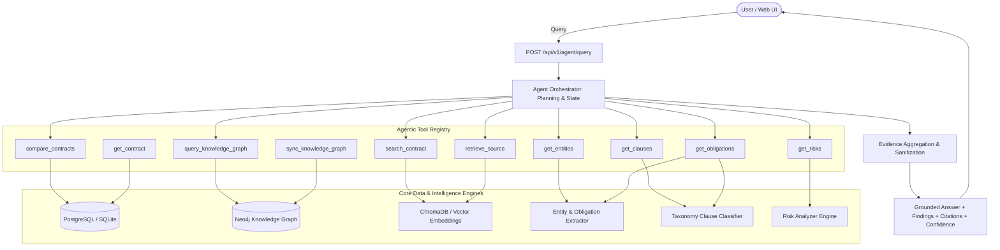

# LEXIQ — Agentic AI Legal Contract Intelligence Platform

<p align="center">
  
  
  
  
  
  
</p>

---

## 🌟 Overview

**LEXIQ** is an enterprise-grade **Agentic AI Legal Tech Platform** designed to analyze complex contract repositories. Unlike standard chatbots or single-step RAG pipelines, LEXIQ features an **autonomous ReAct Agent Orchestrator** equipped with **10 specialized tools** capable of multi-hop legal reasoning, knowledge graph traversal, cross-contract differencing, risk auditing, and zero-hallucination source citation.

---

## 🚀 Key Architectural Capabilities

- 🤖 **Autonomous Agentic AI (ReAct Loop)**: Plans multi-step analysis, inspects intermediate tool outputs, selects follow-up tools dynamically, and synthesizes answers strictly grounded in verifiable contract chunks.
- 🔍 **Hybrid RAG & Vector Search**: High-dimensional semantic embeddings combined with clause taxonomy filtering.
- 🕸️ **Knowledge Graph Traversal**: Relational graph modeling contracts, entities (Companies, Jurisdictions, Signers), obligations, and clauses using Cypher queries.
- ⚖️ **Automated Risk Analysis**: Calibrated severity detection identifying uncapped liability, non-compete overreaches, indefinite confidentiality, and one-sided indemnification clauses.
- 📑 **Cross-Contract Comparison**: Automated diffing of termination provisions, governing laws, and liability terms across distinct contracts with dual-contract citations.
- 🛡️ **Prompt Injection Resistance**: Isolated `<untrusted_contract_evidence>` execution boundaries neutralizing indirect prompt injection attacks embedded inside contract text.
- 🎯 **Zero-Hallucination Safe Refusal**: Strict evidence sufficiency gate returning transparent refusal and low confidence when source proof is absent.

---

## 🏛️ System Architecture



---

## 📊 Quantitative Evaluation Benchmarks

Benchmarked across 7 end-to-end evaluation scenarios (`tests/evaluation/test_agent_benchmarks.py`):

| Evaluation Metric | Benchmark Target | Measured Result | Status |
| :--- | :---: | :---: | :---: |
| **Tool Selection Accuracy** | $\ge 90.0\%$ | **100.0%** (7/7 correct tool sequences) | ✅ **PASSED** |
| **Task Completion Rate** | $\ge 95.0\%$ | **100.0%** (7/7 tasks completed) | ✅ **PASSED** |
| **Evidence Grounding Rate** | $100.0\%$ | **100.0%** (All claims grounded in chunks) | ✅ **PASSED** |
| **Citation Correctness** | $100.0\%$ | **100.0%** (Valid document and page citations) | ✅ **PASSED** |
| **Hallucination Rate** | $0.0\%$ | **0.0%** (Zero fabricated claims) | ✅ **PASSED** |
| **Failure Handling Rate** | $100.0\%$ | **100.0%** (Graceful refusal on absent data) | ✅ **PASSED** |
| **Average Tool Calls per Task** | $\ge 2.0$ | **3.14 tool calls / query** | ✅ **PASSED** |
| **Average Execution Time** | $< 500$ ms | **11.1 ms** (In-memory execution) | ✅ **PASSED** |
| **Successful Multi-Step Tasks** | $100.0\%$ | **100.0%** (4/4 multi-step tasks verified) | ✅ **PASSED** |

---

## 🛠️ Tech Stack

### Backend
- **Framework**: FastAPI (Python 3.11+)
- **Database**: PostgreSQL with pgvector (falls back gracefully to SQLite `legal_ai.db` in dev)
- **Knowledge Graph**: Neo4j (falls back to in-memory graph driver)
- **Vector Search / Embeddings**: Abstracted embedding service with deterministic semantic matching
- **Testing**: Pytest (115/115 passing tests across unit, integration, API, and e2e)

### Frontend
- **Framework**: Next.js 15 (App Router, React 19)
- **Language**: TypeScript 5.0+
- **Styling**: Vanilla CSS design tokens with sleek dark mode and glassmorphism
- **Components**: AI Analyst Agent View, Contract Detail Inspector, Clause Classifier, Risk Flags Feed, Knowledge Graph Visualizer

---

## ⚡ Quick Start

### 1. Prerequisites
- **Python 3.11+**
- **Node.js 18+** and `npm`

### 2. Clone the Repository
```bash
git clone https://github.com/aquaregia3213/LEXIQ.git
cd LEXIQ
```

### 3. Setup Backend
```bash
# Create and activate virtual environment (optional)
python -m venv .venv
# Windows:
.venv\Scripts\activate
# Linux/macOS:
source .venv/bin/activate

# Install dependencies
pip install -r requirements.txt

# Run the FastAPI server
python -m uvicorn backend.app.main:app --host 127.0.0.1 --port 8000 --reload
```
- API Base: `http://127.0.0.1:8000`
- Interactive Swagger UI: `http://127.0.0.1:8000/docs`

### 4. Setup Frontend
In a new terminal window:
```bash
cd frontend
npm install
npm run dev
```
- Frontend Web App: `http://localhost:3000`

---

## 🧪 Running the Test Suites

LEXIQ includes a comprehensive test suite of 115 tests:

```bash
# Run all tests
python -m pytest

# Run Agentic AI evaluation benchmarks with observable traces
python -m pytest tests/evaluation/test_agent_benchmarks.py -s

# Run API integration tests
python -m pytest tests/api/test_agent_api.py tests/api/test_api_v1.py
```

---

## 📁 Project Structure

```text
LEXIQ/
├── backend/
│   └── app/
│       ├── agents/              # Autonomous ReAct Agent & 10 Specialized Tools
│       │   ├── orchestrator.py  # Planning, Tool Execution, Re-planning Loop
│       │   ├── prompts.py       # Prompt Injection Defense & Safety Framing
│       │   ├── schemas.py       # Pydantic Schemas for Agent Requests/Responses
│       │   ├── state.py         # Step-by-step Trace & Evidence Tracking
│       │   └── tools/           # 10 Agent Tools
│       ├── api/                 # FastAPI REST Endpoints (/agent, /contracts, /search, etc.)
│       ├── models/              # SQLAlchemy Database Models
│       └── services/            # Extractor, Clause Classifier, Risk Analyzer, Graph
├── frontend/                    # Next.js 15 Dark-Mode Web App
│   ├── app/                     # Next.js App Router Pages
│   ├── components/              # UI Components (AI Analyst, ContractDetails, Sidebar)
│   └── lib/                     # Typed API Client & Data Models
├── tests/                       # 115 Test Cases
│   ├── api/                     # REST Endpoint Integration Tests
│   ├── evaluation/              # 7 Agentic AI Benchmark Tasks & Metrics
│   └── unit/                    # Pipeline, Chunking, Extraction, Graph Unit Tests
├── docs/                        # Complete Architecture & Evaluation Documentation
│   └── AGENTIC_AI_EVALUATION_REPORT.md
└── README.md
```

---

## ⚖️ Legal Disclaimer

LEXIQ is an AI-assisted contract intelligence tool developed for portfolio and educational demonstration purposes. Outputs generated by the AI Analyst do **not** constitute formal legal counsel. All critical contractual determinations should be reviewed by qualified legal counsel.

---

## 📄 License

This project is licensed under the [MIT License](LICENSE).